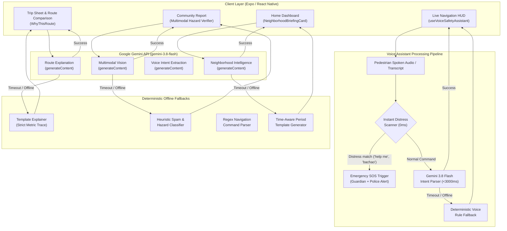

# Gemini 3.8 Flash Safety Intelligence Suite

SafeRoute integrates Google's **Gemini 3.8 Flash** model across client and server runtimes to provide real-time, grounded pedestrian safety intelligence. This document details the architecture, schemas, grounding mechanisms, offline fallback guarantees, and API reference for the four core Gemini features.

---

## Architecture Overview



---

## Environment Variables

| Variable | Target Runtime | Description |
| --- | --- | --- |
| `EXPO_PUBLIC_GEMINI_API_KEY` | Mobile Client (`services/`, `hooks/`, `components/`) | Exposed to client bundle via Expo public env. Used for direct Gemini 3.8 Flash calls from mobile. |
| `GEMINI_API_KEY` | Backend Server (`routing/gemini_explainer.py`, Cloud Functions) | Secure server-side key for route computation engines and automated background pipelines. |

### Resolution Order
- **Client (`services/gemini*.ts`)**:
  1. `process.env.EXPO_PUBLIC_GEMINI_API_KEY`
  2. `process.env.GEMINI_API_KEY`
  3. `Constants.expoConfig?.extra?.geminiApiKey`
  4. If all null/empty: Instantly executes the deterministic offline fallback without network latency.
- **Server (`routing/gemini_explainer.py`)**:
  1. `api_key` argument passed into function
  2. `os.environ.get("GEMINI_API_KEY")`
  3. `os.environ.get("EXPO_PUBLIC_GEMINI_API_KEY")`
  4. If all null/empty: Instantly executes `generate_fallback_explanation(inputs)`.

---

## 1. Natural-Language Route Explanations ("Why This Route?")

### Purpose & Metric Synthesis
Translates dense, multidimensional safety scores into plain, reassuring, single-sentence pedestrian explanations (e.g., *"This route adds 4 mins but avoids 3 unlit service lanes and keeps you within 300 m of a 24/7 police beat box"*).

### Strict Grounding Rules (Zero Hallucination)
1. **Length & Tone**: Exactly one sentence, maximum 35 words. Tone is calm, reassuring, and factual—never alarmist.
2. **Grounding Constraint**: Every statement must directly trace to one of the input metrics:
   - `lightingScore` / `unlitSegmentsAvoided` &rarr; Street lighting, unlit service lanes.
   - `policeDistanceM` / `nearestPoliceName` &rarr; Distance to verified police station or beat post.
   - `entrapmentScore` &rarr; Escape turnings and intersection density.
   - `prospectScore` &rarr; Road width and visibility sightlines.
   - `deltaMinutesVsFastest` &rarr; Added travel time compared to fastest alternative.
3. **No Named Hallucinations**: The model is forbidden from inventing street names, shop names, or landmarks not explicitly supplied in the input JSON.

### TypeScript Client API (`services/geminiRouteExplanation.ts`)

#### Types
```typescript
export type RouteExplanationParams = {
  lightingScore: number;             // [0.05, 1.0] (VIIRS night lighting)
  policeDistanceM: number;           // Distance to nearest police presence in meters
  crimeScore: number;                // [0, 100] (0 = safest, 100 = highest crime)
  crimePercentile?: number | null;   // [0, 100] percentile
  entrapmentScore?: number | null;   // [0.05, 1.0] (1.0 = high escape density)
  prospectScore?: number | null;     // [0.05, 1.0] (1.0 = wide, unobstructed road)
  unlitSegmentsAvoided?: number | null; // Count of bypassed low-lighting segments
  timeOfDayHour: number;             // 0.0 to 24.0
  deltaMinutesVsFastest: number;     // >= 0.0 (added travel time vs fastest route)
  safetyDeltaVsFastest: number;      // >= 0.0 (safety score advantage)
  nearestPoliceName?: string | null; // e.g., "Kurla Police Beat Box"
  destinationName?: string | null;
};
```

#### Functions
- `explainRouteWithGemini(params: RouteExplanationParams, timeoutMs?: number): Promise<string>`
  Invokes `gemini-3.8-flash:generateContent` with temperature `0.2` and `maxOutputTokens: 65`. Falls back to `getFallbackRouteExplanation(params)` on network abort or error.
- `getFallbackRouteExplanation(params: RouteExplanationParams): string`
  Deterministic rule-based generator that constructs an identical calm sentence purely from input parameters.

#### Minimal TypeScript Example
```typescript
import { explainRouteWithGemini } from "@/services/geminiRouteExplanation";

const explanation = await explainRouteWithGemini({
  lightingScore: 0.72,
  policeDistanceM: 280,
  nearestPoliceName: "Dadar Police Beat Post",
  crimeScore: 22,
  unlitSegmentsAvoided: 3,
  timeOfDayHour: 22.5,
  deltaMinutesVsFastest: 4,
  safetyDeltaVsFastest: 18,
});

console.log(explanation);
// Output: "This route adds 4 mins but avoids 3 unlit service lanes and keeps you within 280 m of Dadar Police Beat Post."
```

### Python Routing Engine API (`routing/gemini_explainer.py`)

#### Dataclass & Functions
```python
from routing.gemini_explainer import RouteExplanationInputs, generate_gemini_explanation

inputs = RouteExplanationInputs(
    lighting_score=0.68,
    police_dist_m=320.0,
    nearest_police_name="Pydhoni Beat Box",
    crime_score=19.5,
    unlit_segments_avoided=2,
    time_of_day_hour=21.5,
    delta_min_vs_fastest=3.0,
    safety_delta_vs_fastest=14.0,
)

explanation = generate_gemini_explanation(inputs, timeout_s=3.0)
print(explanation)
```

#### Runnable cURL Example
```bash
curl -X POST "https://generativelanguage.googleapis.com/v1beta/models/gemini-3.8-flash:generateContent?key=${GEMINI_API_KEY}" \
  -H "Content-Type: application/json" \
  -d '{
    "contents": [
      {
        "parts": [
          {
            "text": "You are the SafeRoute AI Navigation Assistant. Explain to a pedestrian in ONE sentence why their recommended safe route was chosen over the fastest route.\nSTRICT GROUNDING RULES:\n1. Write ONE concise sentence (max 35 words). Tone: calm, reassuring, factual.\n2. Synthesize metrics into plain language: e.g. \"This route adds 4 mins but avoids 3 unlit service lanes and keeps you within 300 m of a 24/7 police beat box\".\n3. NEVER invent street names or landmarks.\n\nInput Metrics:\n{\n  \"viirs_night_lighting_score\": 0.68,\n  \"unlit_segments_avoided\": 2,\n  \"police_distance_m\": 320,\n  \"nearest_police_name\": \"Pydhoni Beat Box\",\n  \"crime_score\": 19.5,\n  \"minutes_slower_than_fastest\": 3.0,\n  \"points_safer_than_fastest\": 14.0\n}\n\nNatural-Language Explanation:"
          }
        ]
      }
    ],
    "generationConfig": {
      "temperature": 0.2,
      "maxOutputTokens": 65
    }
  }'
```

---

## 2. Multimodal Incident & Hazard Verification

### Purpose & Pipeline
Validates user-submitted community hazard photos using `gemini-3.8-flash` multimodal vision before submitting reports into the public routing graph. Detects real-world street hazards, filters out spam/selfies/memes, grades severity (1–5), and determines automatic moderation status.

### Hazard Taxonomy
| Category Key | Display Label | Description |
| --- | --- | --- |
| `broken_streetlights` | Broken Streetlight / Dark Zone | Non-functional streetlights, pitch-black road stretches |
| `deserted_alley` | Deserted Alley / Isolated Passage | Enclosed, unpopulated, narrow alleys with low visibility |
| `waterlogging` | Waterlogged Road / Flooded Footpath | Monsoonal flooding, submerged walkways, hidden drains |
| `blocked_sidewalk` | Blocked Sidewalk / Pedestrian Obstacle | Construction debris, barricades forcing pedestrians onto road |
| `harassment_risk` | Harassment Risk / Secluded Corner | Dark unmonitored blindspots, unlit underpasses |
| `suspicious_activity`| Suspicious Activity | Loitering or hostile conditions |
| `road_obstruction` | Road Obstruction / Dangerous Pothole | Open trenches, severe potholes, broken pavement |
| `spam_or_irrelevant`| Spam or Irrelevant Photo | Selfies, memes, indoor rooms, screenshots, non-road images |

### Moderation Actions
- `auto_approved`: Genuine physical hazard with confidence $\ge 0.85$.
- `flagged_for_human_review`: Genuine hazard or uncertain category with confidence $< 0.85$.
- `rejected_spam`: Classified as `spam_or_irrelevant` or non-hazard. Blocks report submission.

### TypeScript Client API (`services/geminiHazardVerification.ts`)

#### Types
```typescript
export type HazardVerificationResult = {
  isAuthenticHazard: boolean;
  classifiedCategory: HazardCategory;
  displayLabel: string;
  confidence: number;      // 0.0 to 1.0
  severity: number;        // 1 (minor) to 5 (imminent danger)
  summary: string;         // Concise 1-sentence moderation summary
  moderationAction: "auto_approved" | "flagged_for_human_review" | "rejected_spam";
  suggestedWarning?: string;
  modelUsed: string;       // "gemini-3.8-flash" or fallback indicator
};

export type VerifyHazardPhotoParams = {
  base64Image?: string;    // Raw or data URI base64 encoded image
  mimeType?: string;       // Defaults to "image/jpeg"
  userCategory?: string;
  userDescription?: string;
  timeoutMs?: number;      // Defaults to 6000ms
};
```

#### Minimal TypeScript Example
```typescript
import { verifyHazardPhotoWithGemini } from "@/services/geminiHazardVerification";

const verification = await verifyHazardPhotoWithGemini({
  base64Image: "data:image/jpeg;base64,/9j/4AAQSkZJRg...",
  userCategory: "Lighting",
  userDescription: "Streetlight is broken and the entire walkway is in total darkness",
});

console.log(verification.moderationAction); // "auto_approved" | "flagged_for_human_review" | "rejected_spam"
console.log(verification.classifiedCategory); // "broken_streetlights"
console.log(verification.severity); // 3 (1-5 scale)
console.log(verification.summary); // "Verified genuine community hazard matching reported category: Broken Streetlight / Dark Zone."
```

#### Interactive Simulation Presets (`SAMPLE_HAZARD_PRESETS`)
Included in `services/geminiHazardVerification.ts` to allow instant testing and verification within mobile environments without live street photography:
- `sample_broken_light`: Streetlight failure leaving pedestrian path dark.
- `sample_deserted_alley`: Narrow unpopulated passage after 9 PM.
- `sample_waterlogging`: Flooded roadway concealing hazards.
- `sample_spam`: Irrelevant selfie/meme to test spam rejection.

#### Runnable cURL Example
```bash
curl -X POST "https://generativelanguage.googleapis.com/v1beta/models/gemini-3.8-flash:generateContent?key=${GEMINI_API_KEY}" \
  -H "Content-Type: application/json" \
  -d '{
    "contents": [
      {
        "parts": [
          {
            "inlineData": {
              "mimeType": "image/jpeg",
              "data": "'$(base64 -w 0 path/to/streetlight.jpg)'"
            }
          },
          {
            "text": "Analyze this community hazard photo. Output valid JSON with keys: is_authentic_hazard, hazard_type, confidence, severity, summary, moderation_action."
          }
        ]
      }
    ],
    "generationConfig": {
      "temperature": 0.1,
      "responseMimeType": "application/json",
      "maxOutputTokens": 200
    }
  }'
```

---

## 3. Hands-Free / Voice-Activated Safety Assistant

### Purpose & Architecture
Allows pedestrians walking with earphones at night to stay protected and control navigation hands-free without looking down at a phone screen.

```
                    ┌───────────────────────────────┐
                    │ Spoken Input via Earphones    │
                    └──────────────┬────────────────┘
                                   │
                                   ▼
                ┌───────────────────────────────────────┐
                │ Tier 1: 0ms Regex Distress Scanner   │
                │ Checks English, Hindi, Marathi terms  │
                └───────┬───────────────────────┬───────┘
                        │                       │
              [Match Found]               [No Distress Match]
                        │                       │
                        ▼                       ▼
      ┌───────────────────────────┐   ┌───────────────────────────┐
      │ Instant Emergency SOS     │   │ Tier 2: Gemini 3.8 Flash │
      │ - Trigger SOS dispatch    │   │ Intent Understanding      │
      │ - Alert guardians & police│   │ - "reroute_safest"        │
      │ - Reassuring earphone TTS │   │ - "find_police"           │
      └───────────────────────────┘   │ - "status_check"          │
                                      │ - "report_hazard"         │
                                      └─────────────┬─────────────┘
                                                    │
                                                    ▼
                                      ┌───────────────────────────┐
                                      │ Deterministic Fallback    │
                                      │ (If network drops)        │
                                      └───────────────────────────┘
```

### Tier 1: Instant Distress Scanner (0ms Latency)
Scans the transcript locally using regex against high-risk phrases before making any network calls:
- **English**: `help`, `help me`, `being followed`, `someone is following`, `danger`, `call police`, `emergency`, `sos`.
- **Hindi / Marathi**: `bachao`, `madad`, `choro`, `police ko bulao`, `koi peeche hai`.

**Action**: If matched, immediately returns `intent: "distress_emergency"`, `isEmergency: true`, triggers an error haptic pattern, alerts guardians via SOS, and returns a calming earphone audio prompt.

### Tier 2: Gemini 3.8 Flash Semantic Intent Parser
For standard navigation commands, Gemini extracts the intent and synthesizes a brief (max 20 words), reassuring earphone response.

#### Supported Intent Actions
| Intent | Action Required | Trigger Examples | Spoken Response Format |
| --- | --- | --- | --- |
| `distress_emergency` | `trigger_sos` | "Help me, someone is behind me" | "Emergency mode activated. Your live location has been shared with your guardians and nearby police. Stay on the main road." |
| `reroute_safest` | `reroute_safest` | "Take me on the safest well-lit street" | "Rerouting to the safest well-lit path. Bypassing unlit service lanes." |
| `find_police` | `find_police` | "Where is the nearest police station?" | "Nearest police presence is Kurla Police Beat Box, 280 meters ahead on the main street." |
| `status_check` | `speak_status` | "How far is my destination and am I safe?" | "You are on a well-lit street with active visibility. Estimated 4 minutes remaining." |
| `report_hazard` | `report_hazard` | "Report broken streetlight here" | "Hazard logged at your current GPS coordinates for community verification." |

### React Hook Usage (`hooks/useVoiceSafetyAssistant.ts`)
```tsx
import { useVoiceSafetyAssistant } from "@/hooks/useVoiceSafetyAssistant";

export function NavigationScreen() {
  const voice = useVoiceSafetyAssistant({
    context: {
      currentStreetName: "Linking Road",
      nearestPoliceName: "Santacruz Police Station",
      policeDistanceM: 250,
      etaMinutes: 6,
      lightingStatus: "well-lit",
    },
    onEmergencyTriggered: (result) => {
      triggerSosDispatch(result);
    },
    onRerouteRequested: () => {
      calculateSafestAlternative();
    },
    onFindPoliceRequested: () => {
      navigateToNearestPolice();
    },
  });

  return (
    <Pressable onPress={voice.toggleHandsFreeMode}>
      <Text>{voice.isEnabled ? "Hands-Free Active" : "Enable Hands-Free"}</Text>
    </Pressable>
  );
}
```

### Direct TypeScript Service API (`services/geminiVoiceSafetyAssistant.ts`)
```typescript
import {
  checkInstantDistress,
  processVoiceSafetyCommand,
} from "@/services/geminiVoiceSafetyAssistant";

// 1. Instant 0ms distress scan (no network required)
const emergency = checkInstantDistress("Bachao koi peeche hai!");
if (emergency) {
  console.log(emergency.actionRequired); // "trigger_sos"
  console.log(emergency.isEmergency);    // true
  console.log(emergency.spokenResponse); // "Emergency mode activated..."
}

// 2. Full command processing with Gemini 3.8 Flash + fallback
const result = await processVoiceSafetyCommand("Where is the nearest police station?", {
  nearestPoliceName: "Kurla Police Beat Box",
  policeDistanceM: 280,
  etaMinutes: 4,
  lightingStatus: "well-lit",
});

console.log(result.intent);         // "find_police"
console.log(result.actionRequired); // "find_police"
console.log(result.spokenResponse); // "Nearest police presence is Kurla Police Beat Box, 280 meters ahead on the main street."
```

---

## 4. Dynamic Neighborhood Safety Briefings

### Purpose & Metric Aggregation
Generates time-aware, localized pre-trip intelligence before the user begins walking. Synthesizes:
- **Neighborhood / Ward Name** (e.g., Kurla, Bandra West, Dadar)
- **Time of Day** (Morning Walk, Afternoon, Evening Commute, Night Travel post-9 PM, Late Night post-11 PM)
- **Road Light Density** (VIIRS Satellite radiance score `[0.0, 1.0]`)
- **Police Proximity** (Distance in meters to nearest station or 24/7 beat box)
- **Community Hazards** (Active reported hazards count)
- **Pedestrian Crowd Density** (Active vs quiet commercial corridors)

### Example Output
> *"You're traveling after 10 PM in Kurla. Linking Road remains well-lit and active until midnight, but pedestrian crossways near the station have reduced lighting."*

### Risk Classification
- `low`: High lighting score ($\ge 0.60$), active crowd flow, close police proximity.
- `moderate`: Intermediate lighting ($0.40 - 0.59$), reduced foot traffic.
- `caution`: Late-night hour ($> 22:00$), low lighting score ($< 0.40$), or active reported unlit hazards.

### TypeScript API (`services/geminiNeighborhoodBriefing.ts`)

#### Schema
```typescript
export type NeighborhoodSafetyBriefing = {
  headline: string;           // E.g., "Well-lit corridors active in Kurla"
  briefing: string;           // 25 - 45 words maximum
  timeContext: string;        // E.g., "Late Night (Post-11 PM)"
  riskLevel: "low" | "moderate" | "caution";
  highlights: string[];       // Max 3 bullet points
  audioBriefingText: string;  // Text formatted for audio playback
  modelUsed: string;          // "gemini-3.8-flash" or fallback indicator
};
```

#### UI Component (`components/safety/NeighborhoodBriefingCard.tsx`)
Mounted on `app/(tabs)/Home.tsx` and `components/maps/MapTripSheet.tsx`. Features:
- Automatic time-of-day detection.
- Audio playback toggle button with earphone indicator.
- Refresh trigger with spinning state.
- Highlights pills indicating police station distance and well-lit thoroughfares.

#### Minimal TypeScript Example
```typescript
import { generateNeighborhoodSafetyBriefing } from "@/services/geminiNeighborhoodBriefing";

const briefing = await generateNeighborhoodSafetyBriefing({
  areaName: "Kurla",
  hour: 22,
  lightingScore: 0.68,
  policeDistanceM: 280,
  nearestPoliceName: "Kurla Station Beat Box",
  nearbyHazardsCount: 1,
});

console.log(briefing.headline);    // "Well-lit corridors active in Kurla"
console.log(briefing.riskLevel);   // "low" | "moderate" | "caution"
console.log(briefing.briefing);    // "You're traveling after 10 PM in Kurla. Linking Road remains well-lit..."
console.log(briefing.highlights);  // ["Main arterial roads well-lit", "Kurla Station Beat Box within 280 m"]
```

#### Runnable cURL Example
```bash
curl -X POST "https://generativelanguage.googleapis.com/v1beta/models/gemini-3.8-flash:generateContent?key=${GEMINI_API_KEY}" \
  -H "Content-Type: application/json" \
  -d '{
    "contents": [
      {
        "parts": [
          {
            "text": "You are the SafeRoute Neighborhood Pre-Trip Safety Intelligence Engine.\nTask: Generate a dynamic, time-aware pedestrian safety briefing for Kurla at 22:00.\nStyle example: \"You'\''re traveling after 10 PM in Kurla. Linking Road remains well-lit and active until midnight, but pedestrian crossways near the station have reduced lighting.\"\nGROUNDING RULES:\n1. Directly cite neighborhood name and time context.\n2. Ground claims strictly on metrics (lighting score: 0.68, police distance: 280m, hazards: 1).\n3. Briefing text MUST be 25 to 45 words maximum.\nOutput valid JSON with keys: headline, briefing, risk_level, highlights, audio_briefing_text."
          }
        ]
      }
    ],
    "generationConfig": {
      "temperature": 0.2,
      "responseMimeType": "application/json",
      "maxOutputTokens": 200
    }
  }'
```

---

## 5. Automated Testing & Verification Suite

SafeRoute maintains two automated test suites covering all four Gemini 3.8 Flash safety features, zero-hallucination constraints, metric grounding, and deterministic offline fallback guarantees.

### Test Execution Commands

| Target Runtime | Framework / Runner | Command | Test File |
| --- | --- | --- | --- |
| Mobile Client / TypeScript | Node.js Test Runner (`--experimental-strip-types`) | `npm test` or `npm run test:gemini` | `tests/test_gemini_features.ts` |
| Routing Engine / Python | Python `unittest` Runner | `npm run test:python` | `tests/test_gemini_explainer.py` |

### 1. TypeScript & Node.js Test Suite (`tests/test_gemini_features.ts`)

Executes 10 unit and integration tests across the client services without requiring live Google API credentials:

```bash
npm test
# or: npm run test:gemini
```

#### Coverage Matrix

| Test Suite Case | Target Module | What It Verifies |
| --- | --- | --- |
| `Feature 1: Route Explanations - Deterministic Fallback & Metric Grounding` | `services/geminiRouteExplanation.ts` | Verifies deterministic template generates grounded explanations containing added minutes (`adds 4 mins`), unlit lane bypass (`avoids 3 unlit service lanes`), and police beat box distance (`keeps you within 300 m`). Also tests 0 added minutes phrasing (`This route ...`). |
| `Feature 1: Route Explanations - Offline Graceful Degradation` | `services/geminiRouteExplanation.ts` | Verifies async `explainRouteWithGemini()` smoothly degrades to deterministic fallback without throwing when API key is missing or offline. |
| `Feature 2: Multimodal Hazard Verification - Spam & Irrelevant Filtering` | `services/geminiHazardVerification.ts` | Validates that selfie, meme, and non-hazard descriptions are classified as `spam_or_irrelevant`, marked `rejected_spam`, and blocked with high confidence ($\ge 0.85$). |
| `Feature 2: Multimodal Hazard Verification - Authentic Hazard Classification` | `services/geminiHazardVerification.ts` | Verifies genuine hazard detection across `broken_streetlights` (auto-approved), `waterlogging`, and `deserted_alley` categories. |
| `Feature 2: Multimodal Hazard Verification - Sample Presets Verification` | `services/geminiHazardVerification.ts` | Loops through all `SAMPLE_HAZARD_PRESETS` (`sample_broken_light`, `sample_deserted_alley`, `sample_waterlogging`, `sample_spam`) and verifies correct classification and moderation action. |
| `Feature 3: Voice Safety Assistant - Instant 0ms Distress Scanner` | `services/geminiVoiceSafetyAssistant.ts` | Verifies local regex scanner immediately identifies emergency phrases in **English** (`help me`, `call police`), **Hindi** (`bachao`, `madad`, `police ko bulao`), and **Marathi** (`choro`, `koi peeche hai`), returning `trigger_sos` and emergency TTS without network calls. Confirms normal questions return `null`. |
| `Feature 3: Voice Safety Assistant - Navigation Intent Parsing` | `services/geminiVoiceSafetyAssistant.ts` | Verifies deterministic fallback parsing for `reroute_safest`, `find_police` (synthesizing station name and distance), and `status_check` (synthesizing ETA and lighting). |
| `Feature 3: Voice Safety Assistant - Preset Commands Verification` | `services/geminiVoiceSafetyAssistant.ts` | Iterates across `VOICE_COMMAND_TEST_PRESETS`, ensuring both emergency and non-emergency voice commands produce actionable results. |
| `Feature 4: Dynamic Neighborhood Safety Briefing - Time & Context Awareness` | `services/geminiNeighborhoodBriefing.ts` | Verifies late night post-11 PM warnings trigger `caution` risk level with dark alley avoidance advice, while afternoon commutes trigger `low` risk level with active foot traffic highlights. |
| `Feature 4: Dynamic Neighborhood Safety Briefing - Async Fallback Execution` | `services/geminiNeighborhoodBriefing.ts` | Verifies async `generateNeighborhoodSafetyBriefing()` completes reliably and produces headline, briefing, highlights, and audio text. |

### 2. Python Routing Engine Test Suite (`tests/test_gemini_explainer.py`)

Executes 5 unit tests validating the backend Gemini route explanation engine and zero-hallucination guarantees:

```bash
npm run test:python
# or: python -m unittest tests/test_gemini_explainer.py
```

#### Coverage Matrix

| Test Method | Function Tested | What It Verifies |
| --- | --- | --- |
| `test_fallback_with_added_time_and_unlit_avoidance` | `generate_fallback_explanation` | Confirms synthesis of added travel time (`adds 4 mins`), unlit service lane count (`avoids 3 unlit service lanes`), and police distance (`keeps you within 300 m of a 24/7 police beat box`). |
| `test_fallback_without_added_time` | `generate_fallback_explanation` | Validates phrasing when delta minutes is 0 (omits "adds" prefix) and includes named police facilities (`Bandra Police Station`). |
| `test_fallback_escape_and_prospect` | `generate_fallback_explanation` | Tests synthesis of high entrapment scores into `open intersections with clear escape paths` and wide prospect corridors. |
| `test_generate_gemini_explanation_graceful_offline_fallback` | `generate_gemini_explanation` | Validates that passing `api_key=None` cleanly invokes the deterministic fallback template without raising network exceptions. |
| `test_zero_hallucination_guarantee` | `generate_fallback_explanation` | Proves that ungrounded landmarks (e.g., `Kurla`, `Linking Road`) are never fabricated when omitted from input metrics. |

---

## 6. Summary of Fallback Guarantees

Every Gemini feature in SafeRoute is backed by a deterministic, offline-capable fallback function. Under no circumstances will a missing API key, network timeout, rate limit, or server outage break user navigation, prevent SOS dispatch, or throw an unhandled exception:

| Feature | Primary Service | Offline / Error Fallback | Resilience Guarantee |
| --- | --- | --- | --- |
| Route Explanation | `explainRouteWithGemini` | `getFallbackRouteExplanation` | Returns mathematically grounded explanation string matching input metrics. |
| Python Route Explainer | `generate_gemini_explanation` | `generate_fallback_explanation` | Returns identical calm format string. |
| Hazard Verification | `verifyHazardPhotoWithGemini` | `getFallbackHazardVerification` | Applies heuristic text matching; prevents blocking legitimate reports when offline. |
| Voice Assistant | `processVoiceSafetyCommand` | `parseFallbackVoiceCommand` | 0ms Regex distress scan runs first; deterministic offline rule parser handles navigation intents. |
| Safety Briefing | `generateNeighborhoodSafetyBriefing` | `getFallbackNeighborhoodBriefing` | Time-of-day clock determines tailored lighting and corridor advice. |
